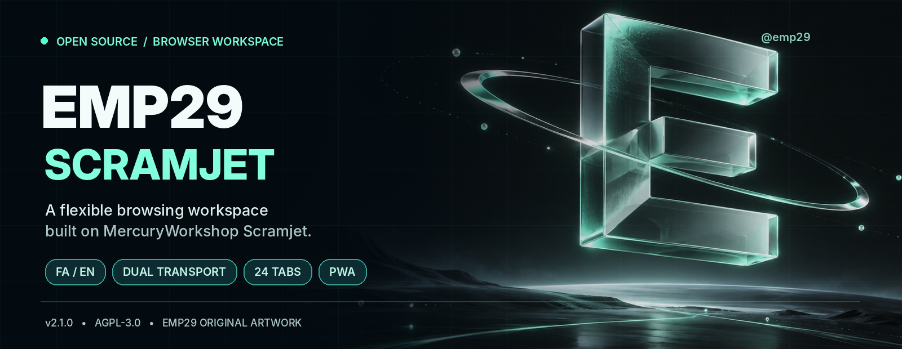
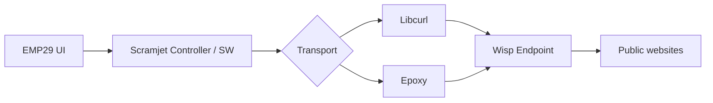

<div align="center">



# EMP29 Pro 2.1 · Scramjet

**A flexible, bilingual browser workspace powered by open-source Scramjet**

Workspaces · Split view · Dual transport · Persian / English · Local-first settings

**Self-hosted Scramjet web proxy workspace** with Wisp WebSocket transport, WebAssembly/WASM rewriting, tab management and connection diagnostics.

[](CHANGELOG.md)
[](https://github.com/solohkemp-tech/EMP29-Scramjet/actions/workflows/emp29.yml)
[](LICENSE)
[](https://nodejs.org/)
[](https://t.me/emp29)

**[Use cases](#use-cases)** · **[Quick start](#quick-start)** · **[Features](#features)** · **[Deployment](#deployment)** · **[Documentation](#documentation)** · **[فارسی](README.md)**

</div>

---

## ✦ Overview

EMP29 Scramjet is an independent, customized build of [MercuryWorkshop/Scramjet](https://github.com/MercuryWorkshop/scramjet), combining a bilingual interface with resource-aware browsing tools. This repository contains both the **matching source code** and **prebuilt local runtime**. Installing the release does not require rebuilding Rust or WASM.

| **24 tabs** | **8 workspaces** | **12 saved sessions** | **2 transports** |
|:---:|:---:|:---:|:---:|
| Tab/resource controls | Named, color-coded | Lazy restoration | Libcurl / Epoxy |

> [!IMPORTANT]
> Scramjet is an experimental web rewriting engine. Compatibility with every website, DRM, video service, or improved network speed is **not guaranteed**. EMP29 is not a VPN, anonymity, or fingerprint-protection product.

<a id="use-cases"></a>
## Who is EMP29 for?

- **Developers exploring web rewriting:** study Scramjet, Service Workers, Wisp and a WASM-based JavaScript rewriter in a self-hosted open-source project.
- **Self-hosting enthusiasts:** use a bilingual browser workspace locally or behind a correctly configured HTTPS reverse proxy.
- **People organizing research:** manage tabs, workspaces, reading notes and connection troubleshooting from one interface.

**Security and compatibility limits:** EMP29 is not a VPN, an anonymity service or an isolated browser profile. Support for specific websites, DRM and video playback is not guaranteed.

<a id="features"></a>
## ◈ Features

| 🧭 **Navigation and workspaces** | 🌐 **Internationalization and appearance** |
|---|---|
| Up to 24 tabs, eight workspaces, pin/reopen, command search, split view, and 12 saved sessions | Live Persian/English switching, RTL/LTR, locally served Vazirmatn, dark/light/system themes, and reduced motion |
| 📚 **Reading and personal data** | ⚙️ **Transports and diagnostics** |
| On-demand Readability, a 15-article library, notes and Markdown export, bookmarks/history, JSON backup | Libcurl/Epoxy with automatic fallback, Wisp protocol probes, manual switching and connection repair |
| 🪶 **Resource management** | 🛡️ **Deployment protections** |
| Live-frame budgets, lazy session restoration, balanced/light/video presets and bounded public-asset caching | Optional scrypt password access, Origin checks, login limits and filtering of private-network destinations |

Other features include multiple search providers, keyboard shortcuts, optional domain-based tracker blocking and installable PWA support. Workspaces share cookies and are not separate browser profiles. [Full feature reference →](docs/GUIDE_EN_FULL.md#features)

<a id="quick-start"></a>
## ⚡ Quick start

**Requirements:** Node.js **24 LTS** is recommended; minimum supported runtime is **22.16**. Installing npm dependencies requires network access.

<details open>
<summary><strong>Windows / PowerShell</strong></summary>

```powershell
git clone https://github.com/solohkemp-tech/EMP29-Scramjet.git
cd .\EMP29-Scramjet\emp29
npm ci --omit=dev --ignore-scripts
npm run doctor
npm start
```

If you already extracted the project, `Run_EMP29.bat` in the repository root installs production dependencies when needed and starts the app.

</details>

<details>
<summary><strong>Linux / macOS</strong></summary>

```bash
git clone https://github.com/solohkemp-tech/EMP29-Scramjet.git
cd EMP29-Scramjet/emp29
npm ci --omit=dev --ignore-scripts
npm run doctor
npm start
```

For Linux and macOS, use the commands above from the `emp29` directory. Alternatively, run `bash run.sh` **from the repository root**; this launcher exists and starts the app from `emp29`.

</details>

Open **http://localhost:3030** and stop the server with `Ctrl+C`.

For optional password protection, run `npm run setup` in `emp29` before starting. Never commit `emp29/.env` or a backup containing credentials.

<a id="architecture"></a>
## ⬡ How it works



This is a simplified overview of the client, rewriting/control layer, transports, and Wisp tunnel. The transport fallback and readiness checks are meant to improve startup robustness, not promise faster video or network performance.

<a id="performance"></a>
## ◉ Version 2.1 engineering notes

| Change | Recorded result |
|---|---|
| JavaScript/WASM rewrite | In a local 25-rewrite fixture, WASM module construction went from **25** to **1**, with identical rewritten outputs. |
| Controller/Worker startup | Shared validated binary fetch, retryable failures, bounded byte conversion |
| Startup ordering | Actual controller readiness awaited before continuing |
| Validation | **57 tests passed** in the recorded validation environment |

These measurements do **not** establish a browser, network or video speed multiplier. See [Validation](VALIDATION.md), [Version comparison](COMPARISON.md) and [Changelog](CHANGELOG.md).

<a id="deployment"></a>
## ☁️ Remote deployment

Remote browser clients need a **valid HTTPS origin** for Service Workers and a correctly configured WebSocket reverse proxy. Host EMP29 at your domain root and keep the internal app port private.

```bash
cd /opt/emp29/emp29
npm ci --omit=dev --ignore-scripts
npm run setup
npm run doctor
```

Examples are available in [`emp29/deploy/`](emp29/deploy/): **Caddy, Nginx, systemd and Docker Compose**. Set `EMP29_ORIGIN` to the public HTTPS origin and review proxy settings before publishing. These examples have not been validated against your particular remote server.

[Full deployment instructions](docs/GUIDE_EN_FULL.md#deploy-or-upgrade) · [Upgrade and rollback](RELEASE.md) · [Security boundaries](SECURITY.md)

<a id="documentation"></a>
## ▤ Documentation

| Resource | Contents |
|---|---|
| [Full English guide](docs/GUIDE_EN_FULL.md) · [راهنمای فارسی](docs/GUIDE_FA_FULL.md) | Detailed runtime, features, deployment, and troubleshooting |
| [Validation](VALIDATION.md) | Tests, performance evidence and limitations |
| [Comparison](COMPARISON.md) · [Research](RESEARCH.md) | Technical comparisons and references |
| [Release notes](RELEASE.md) · [Changelog](CHANGELOG.md) | Upgrade and rollback procedures |
| [Security](SECURITY.md) · [License](LICENSE) | Deployment risks, security reporting and obligations |
| [Original upstream guide](UPSTREAM_README.md) | MercuryWorkshop's original project README |

<details>
<summary><strong>Develop from source</strong></summary>

```bash
cd emp29
npm ci
npm run build
npm test
npm run check
```

Rebuild and repackage after modifying sources so the runtime and downloaded `source.zip` correspond to the same changes. See the [full English guide](docs/GUIDE_EN_FULL.md#development-and-licensing) for packaging commands and Rust provenance.

</details>

## ♡ Credits and contributing

EMP29 is an independent customized distribution built on [MercuryWorkshop/Scramjet](https://github.com/MercuryWorkshop/scramjet), not an official MercuryWorkshop release. Upstream attribution and third-party notices are preserved. EMP29 and its corresponding source are distributed under **AGPL-3.0-only**, subject to the applicable source-availability obligations.

If EMP29 is useful to you, consider **starring** the repository or filing a reproducible issue to help other users discover and improve it.

**Contributing:** [Contribution guide](CONTRIBUTING.md) · [Issues](https://github.com/solohkemp-tech/EMP29-Scramjet/issues)

**Contact:** [Telegram @emp29](https://t.me/emp29) · [Issues](https://github.com/solohkemp-tech/EMP29-Scramjet/issues) · [Security reporting](SECURITY.md)

<div align="center">

---

**EMP29 © 2026** · Powered by open-source Scramjet · [Back to top ↑](#emp29-pro-21--scramjet)

</div>
