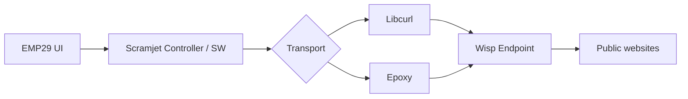

<div align="center">


# EMP29 Pro 2.1 · Scramjet

**یک فضای کاری مدرن برای مرور وب، بر پایه موتور متن‌باز Scramjet**

رابط فارسی و انگلیسی · فضاهای کاری چندگانه · مدیریت پیشرفته تب‌ها · کنترل اتصال و موتورهای انتقال

**Self-hosted Scramjet web proxy workspace** · Wisp WebSocket · WebAssembly/WASM rewriter · Persian/English UI · multi-tab navigation. [Read in English](README.en.md).

[](CHANGELOG.md)
[](https://github.com/solohkemp-tech/EMP29-Scramjet/actions/workflows/emp29.yml)
[](LICENSE)
[](https://nodejs.org/)
[](https://t.me/emp29)

**[مناسب چه کسانی است؟](#use-cases)** · **[شروع سریع](#quick-start)** · **[ویژگی‌ها](#features)** · **[نصب روی سرور](#deployment)** · **[مستندات](#documentation)** · **[English](README.en.md)**

</div>

---

<a id="overview"></a>
## ✦ درباره EMP29

**EMP29 Scramjet** یک نسخه توسعه‌یافته از [MercuryWorkshop/Scramjet](https://github.com/MercuryWorkshop/scramjet) است که تجربه‌ای دوزبانه و قابل‌تنظیم برای مرور وب ارائه می‌کند. این مخزن هم **سورس متناظر** و هم **خروجی آماده اجرای محلی** را نگه می‌دارد. برای اجرای نسخه آماده، کامپایل مجدد Rust یا WASM لازم نیست.

| **۲۴ تب** | **۸ فضای کاری** | **۱۲ نشست ذخیره‌شده** | **۲ موتور انتقال** |
|:---:|:---:|:---:|:---:|
| مدیریت تب و منابع | سازمان‌دهی نام‌دار و رنگی | بازیابی تنبل نشست‌ها | Libcurl و Epoxy |

> [!IMPORTANT]
> این پروژه بر پایه فناوری آزمایشی بازنویسی وب Scramjet ساخته شده است. سازگاری همه سایت‌ها، DRM، ویدئو یا سرعت بالاتر شبکه تضمین نمی‌شود. EMP29 ابزار VPN یا ناشناس‌سازی نیست.

<a id="use-cases"></a>
## 🔎 موارد استفاده و مخاطبان پروژه

- **توسعه‌دهندگان وب:** بررسی معماری Scramjet، Service Worker، Wisp، بازنویسی JavaScript و WASM در یک پروژه متن‌باز قابل اجرا.
- **علاقه‌مندان به Self-hosting:** راه‌اندازی یک فضای کاری مرور وب روی localhost یا دامنه HTTPS با پیکربندی مناسب.
- **کاربران فارسی و انگلیسی:** مدیریت تب‌ها، فضای کاری، مطالعه و عیب‌یابی اتصال در یک رابط دوزبانه.

EMP29 یک **VPN، سرویس ناشناس‌سازی یا مرورگر دارای پروفایل‌های کاملاً جداگانه** نیست. سازگاری تمام سایت‌ها و پخش ویدئو تضمین نمی‌شود.

<a id="features"></a>
## ◈ امکانات کلیدی

| 🧭 **فضای کاری و ناوبری** | 🌐 **زبان و ظاهر** |
|---|---|
| حداکثر ۲۴ تب، ۸ فضای کاری، سنجاق تب، بازیابی تب بسته، جست‌وجوی فرمان‌ها و نمای دوگانه | تغییر زنده فارسی/English، RTL/LTR، فونت Vazirmatn، تم تیره/روشن/سیستم و حالت حرکت کمتر |
| 📚 **مطالعه و داده‌ها** | ⚙️ **موتور و اتصال** |
| کتابخانه ۱۵ مقاله با Readability، یادداشت و خروجی Markdown، نشانک، تاریخچه و پشتیبان JSON | انتخاب خودکار یا دستی Libcurl/Epoxy، ارزیابی اتصال Wisp، مسیرهای جایگزین و ابزار تعمیر اتصال |
| 🪶 **کنترل منابع** | 🛡️ **کنترل‌های استقرار** |
| محدودیت تب‌های فعال، بازیابی تنبل، حالت‌های متعادل/سبک/ویدئو و کش محدود فایل‌های عمومی | رمز اختیاری با هش scrypt، کنترل Origin، محدودیت تلاش ورود و فیلتر مقصدهای شبکه خصوصی |

**ویژگی‌های بیشتر:** چهار موتور جست‌وجو، میان‌برهای صفحه‌کلید، فیلتر دامنه‌های ردیاب به‌صورت اختیاری، PWA و ذخیره تنظیمات در همان مرورگر. فضاهای کاری حساب یا کوکی مستقل ایجاد نمی‌کنند. [جزئیات کامل امکانات ←](docs/GUIDE_FA_FULL.md#قابلیت‌ها)

<a id="quick-start"></a>
## ⚡ اجرای سریع

**پیش‌نیاز:** Node.js **24 LTS** پیشنهاد می‌شود؛ حداقل نسخه قابل‌استفاده **22.16** است. نصب بسته‌های npm به اینترنت نیاز دارد.

<details open>
<summary><strong>Windows / PowerShell</strong></summary>

```powershell
git clone https://github.com/solohkemp-tech/EMP29-Scramjet.git
cd .\EMP29-Scramjet\emp29
npm ci --omit=dev --ignore-scripts
npm run doctor
npm start
```

اگر پروژه را قبلاً دانلود و استخراج کرده‌ای، می‌توانی از پوشه اصلی فایل `Run_EMP29.bat` را اجرا کنی؛ این اسکریپت در صورت نیاز وابستگی‌ها را نصب می‌کند.

</details>

<details>
<summary><strong>Linux / macOS</strong></summary>

```bash
git clone https://github.com/solohkemp-tech/EMP29-Scramjet.git
cd EMP29-Scramjet/emp29
npm ci --omit=dev --ignore-scripts
npm run doctor
npm start
```

برای اجرا روی Linux و macOS از دستورهای بالا در پوشه `emp29` استفاده کن.

</details>

**پس از راه‌اندازی:** در مرورگر باز کن: **http://localhost:3030** · توقف سرور: `Ctrl+C`.

برای فعال‌کردن رمز ورود، پیش از `npm start` از پوشه `emp29` دستور `npm run setup` را اجرا کن. فایل حاوی رمز هش‌شده `emp29/.env` را هرگز منتشر نکن.

<a id="architecture"></a>
## ⬡ معماری در یک نگاه



هسته برنامه روی Scramjet و بازنویس WASM آن بنا شده است. انتخاب موتور و بررسی آماده‌بودن اتصال می‌توانند به رفع برخی مشکلات راه‌اندازی کمک کنند؛ این دیاگرام نمای ساده‌شده معماری است.

<a id="performance"></a>
## ◉ تغییرات فنی نسخه 2.1

| موضوع | نتیجه مستند |
|---|---|
| بازنویس JavaScript/WASM | در آزمون محلی ۲۵ بازنویسی، تعداد ساخت ماژول WASM از **۲۵** به **۱** رسید؛ خروجی‌ها برابر بودند. |
| راه‌اندازی Controller و Worker | اشتراک دانلود باینریِ اعتبارسنجی‌شده و امکان تلاش دوباره پس از خطا |
| راه‌اندازی مرورگر | انتظار برای آماده‌شدن واقعی کنترلر پیش از ادامه |
| آزمون‌های بسته | **۵۷ آزمون موفق** در محیط ثبت‌شدهٔ اعتبارسنجی نسخه |

این معیارها ادعای چندبرابر شدن سرعت مرور سایت، شبکه یا ویدئو نیستند. [گزارش اعتبارسنجی و محدودیت‌ها](VALIDATION.md) · [مقایسه نسخه‌ها](COMPARISON.md) · [تاریخچه تغییرات](CHANGELOG.md).

<a id="deployment"></a>
## ☁️ نصب روی سرور

برای دسترسی از دامنه راه دور، **HTTPS معتبر** و پیکربندی WebSocket مورد نیاز است. Service Worker روی HTTP عمومی معمولاً اجرا نمی‌شود. برنامه باید در **ریشه دامنه** منتشر شود و پورت داخلی برنامه عمومی نشود.

```bash
cd /opt/emp29/emp29
npm ci --omit=dev --ignore-scripts
npm run setup
npm run doctor
```

پیکربندی‌های نمونه در مسیر [`emp29/deploy/`](emp29/deploy/) قرار دارند: **Caddy، Nginx، systemd و Docker Compose**. پیش از استقرار عمومی، `EMP29_ORIGIN` و reverse proxy را برای دامنه خودت تنظیم کن؛ تنظیمات نمونه به‌تنهایی به معنی نصب/آزمایش روی سرور واقعی نیستند.

**[راهنمای قدم‌به‌قدم سرور](docs/GUIDE_FA_FULL.md#نصب-روی-سرور-با-دامنه-https)** · **[راهنمای ارتقا و بازگشت](RELEASE.md)** · **[سیاست امنیت و داده‌ها](SECURITY.md)**

<a id="documentation"></a>
## ▤ مستندات و منابع

| سند | کاربرد |
|---|---|
| [راهنمای کامل فارسی](docs/GUIDE_FA_FULL.md) | همه قابلیت‌ها، میان‌برها، استقرار، Docker و رفع خطا |
| [English README](README.en.md) · [Full English guide](docs/GUIDE_EN_FULL.md) | معرفی و دستورالعمل انگلیسی |
| [گزارش اعتبارسنجی](VALIDATION.md) | آزمون‌ها، داده‌های عملکرد و محدودیت‌ها |
| [مقایسه نسخه‌ها](COMPARISON.md) · [یادداشت‌های تحقیق](RESEARCH.md) | تفاوت‌ها و پشتوانه طراحی |
| [راهنمای انتشار](RELEASE.md) · [تاریخچه](CHANGELOG.md) | ارتقا، بازگشت و تغییرات |
| [سیاست امنیت](SECURITY.md) · [مجوز](LICENSE) | محدوده‌های امنیتی و تعهدات مجوز |
| [راهنمای پروژه اصلی](UPSTREAM_README.md) | متن راهنمای Scramjet اصلی |

<details>
<summary><strong>توسعه از روی سورس</strong></summary>

```bash
cd emp29
npm ci
npm run build
npm test
npm run check
```

بعد از تغییر سورس، بستهٔ اجرایی و فایل `source.zip` متناظر باید مجدداً ساخته شوند. دستورهای بسته‌بندی، بازنویس Rust و جزئیات منبع در [راهنمای انگلیسی کامل](docs/GUIDE_EN_FULL.md#development-and-licensing) آمده‌اند.

</details>

<a id="credits"></a>
## ♡ اعتبار پروژه و مشارکت

این پروژه یک توسعهٔ مستقل از [MercuryWorkshop Scramjet](https://github.com/MercuryWorkshop/scramjet) است، نه محصول رسمی MercuryWorkshop. سورس پایه و یادداشت‌های مجوز حفظ شده‌اند. کد و سورس متناظر مطابق **AGPL-3.0-only** توزیع می‌شوند؛ مجوزهای اجزای ثالث در فایل‌های مربوط درج شده‌اند.

اگر این پروژه به کارت آمد، با **Star** کردن مخزن یا ثبت یک گزارش دقیق از تجربه‌ات به بهبود آن کمک کن.

**ارتباط:** [Telegram @emp29](https://t.me/emp29) · [Issues](https://github.com/solohkemp-tech/EMP29-Scramjet/issues) · [گزارش مسائل امنیتی](SECURITY.md)

<div align="center">

---

**EMP29 © 2026** · Built on open-source Scramjet · [بازگشت به بالا ↑](#emp29-pro-21--scramjet)

</div>
